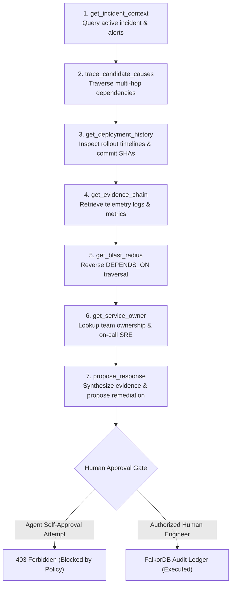

# ImpactGraph: Operational Reasoning & Causal Analysis through Linked Evidence

> **Trace the cause. Map the impact. Act with evidence.**

[](https://docs.falkordb.com/)
[](LICENSE)
[](https://python.org)
[](https://fastapi.tiangolo.com)
[](https://react.dev)
[](https://www.typescriptlang.org)
[](https://vitejs.dev)
[](tests/)

---

**ImpactGraph** (ORACLE) is a graph-native AI incident investigation agent built for **FalkorDB Track 01: Agents That Act on Connected Data**. It traverses multi-hop dependency chains, differentiates competing evidence-backed hypotheses, evaluates customer blast radius, and proposes safe, human-gated remediations with permanent provenance recorded directly into FalkorDB.

---

## 🎯 Track 01 Core Principle

> **"The graph is the source of connected operational context, MCP provides controlled tools to investigate it, and the agent uses retrieved evidence to explain its conclusions. FalkorDB performs connected-data reasoning. The agent selects tools and explains evidence; it never invents graph relationships or bypasses the action policy."**

When complex microservice outages occur, root causes are obscured by cascading alerts across multiple upstream and downstream services. ImpactGraph solves this by:
1. **Tracing Multi-Hop Causality**: Traverses 2–4 hop dependency chains from alerted consumer services to the root failing provider.
2. **Differentiating Competing Hypotheses**: Evaluates competing root-cause theories (e.g., bad deployment vs. newly published CVE) using temporal and graph-grounded evidence.
3. **Explicit Finding Categorization**: Strictly segregates insights into `OBSERVED` (directly supported by graph records), `INFERRED` (hypotheses supported by evidence), and `UNKNOWN` (telemetry gaps honestly reported).
4. **Computing Bounded Blast Radius**: Traverses reverse `DEPENDS_ON` relationships to identify impacted downstream consumers while strictly excluding disconnected negative-test services.
5. **Enforcing Safe Human-Gated Simulation**: Proposes non-destructive actions, rejects agent self-approval (`403 Forbidden`), blocks duplicate execution (`400 Bad Request`), and commits an immutable audit record to FalkorDB.

---

## 🏛️ Graph Schema & Topology

```text
(:Incident)-[:HAS_ALERT]->(:Alert)-[:OBSERVED_ON]->(:Service)
(:Service)-[:DEPENDS_ON]->(:Service)          // (consumer)-[:DEPENDS_ON]->(provider)
(:Service)-[:USES]->(:Package)-[:HAS_VULNERABILITY]->(:Vulnerability)
(:Service)-[:DEPLOYED_IN]->(:Deployment)
(:Team)-[:OWNS]->(:Service)
(:Evidence)-[:SUPPORTS]->(:Incident)
(:Evidence)-[:OBSERVED]->(:Service)
(:Evidence)-[:REFERS_TO]->(:Deployment)
(:AuditLedger)-[:RECORDS]->(:Incident)
```

### Graph Entities & Properties (All Synthetic Data Flagged `is_synthetic: true`)
- **`Incident`**: `id`, `title`, `description`, `severity`, `status`, `created_at`
- **`Alert`**: `id`, `signal`, `alert_type`, `observed_value`, `threshold`, `timestamp`, `source`
- **`Service`**: `id`, `name`, `criticality`, `health`, `status`
- **`Package`**: `id`, `name`, `version`, `risk_status`
- **`Vulnerability`**: `id`, `title`, `severity`, `affected_version`, `published_at`
- **`Deployment`**: `id`, `version`, `timestamp`, `status`, `commit_sha`, `author`
- **`Evidence`**: `id`, `kind`, `source_type`, `source_ref`, `observed_at`, `observation`, `summary`
- **`Team`**: `id`, `name`, `on_call`
- **`AuditRecord`**: `audit_id`, `action_type`, `actor`, `timestamp`, `status`, `notes`

---

## 🎭 Multi-Scenario Demo Suite

ImpactGraph includes **3 fully-grounded operational incident scenarios** that challenge the reasoning agent with distinct graph topologies and evidence patterns:

### Scenario 1: `INC-4091` — Cascading Checkout Failure & 504 Gateway Spike (CRITICAL)
* **Topology**: `web-frontend` → `api-gateway` → `order-service` → `payment-service` (4 hops)
* **Triggered Alerts**: `ALT-881` (504 Timeout Spike on gateway), `ALT-882` (100% Connection Pool Saturation on payment), `ALT-883` (High 5xx Rate on orders).
* **Competing Hypotheses**:
  1. **Canary Rollout `dep-pay-v2.4.1`**: Introduced HikariCP connection pool leak on `payment-service`.
  2. **Shared Package Vulnerability `CVE-2026-4412`**: Remote code execution in `auth-tokens-lib` used by both `order-service` and `payment-service`.
* **Grounded Resolution**:
  * **CONFIRMED**: `dep-pay-v2.4.1` deployed 10 minutes before failure; pool exhaustion occurred 45 seconds post-rollout (`EVI-901`, `EVI-902`).
  * **REFUTED**: `CVE-2026-4412` vulnerability scan was 4 days old; zero exploit payloads observed in ingress logs (`EVI-903`).
* **Blast Radius**: Affects `order-service` (1 hop), `api-gateway` (2 hops), `web-frontend` (3 hops).
* **Negative Test**: Disconnected service `analytics-pipeline` is strictly excluded.
* **Remediation**: Human SRE authorizes `simulate_canary_rollback` to `dep-pay-v2.4.0`.

---

### Scenario 2: `INC-3022` — Redis Cache Stampede & Auth Token Eviction Surge (HIGH)
* **Topology**: `api-gateway` → `auth-service`
* **Triggered Alerts**: `ALT-301` (Cache Eviction Rate Surge > 950 keys/sec), `ALT-302` (P95 Auth Token Verify Latency Elevated > 1400ms).
* **Competing Hypotheses**:
  1. **Config Regression in Rollout `dep-auth-v1.4.2`**: Redis `maxmemory-policy` misconfigured to `volatile-ttl` with a 30-second expiry instead of 24 hours.
  2. **External Ingress DDoS Login Flood**: Malicious bot traffic overwhelming token verification endpoints.
* **Grounded Resolution**:
  * **CONFIRMED**: Config audit log confirms 30-second volatile TTL in deployment manifest (`EVI-301`).
  * **REFUTED**: WAF telemetry shows normal login ingress volume of 118 req/s with 0 DDoS anomaly score (`EVI-302`).
* **Blast Radius**: `api-gateway` session validation degradation.
* **Remediation**: Authorize `simulate_canary_rollback` to stable baseline config.

---

### Scenario 3: `INC-5102` — Logistics Carrier Webhook & Delivery Gateway Timeout (MEDIUM)
* **Topology**: `order-service` → `logistics-service`
* **Triggered Alerts**: `ALT-501` (External Carrier Dispatch Webhook Timeout > 30s), `ALT-502` (RabbitMQ Dead-Letter Queue Threshold Surpassed > 5,200 messages).
* **Competing Hypotheses**:
  1. **Third-Party Carrier Gateway Outage**: Regional upstream outage at external logistics partner endpoint.
  2. **Internal CoreDNS Resolution Failure**: Internal cluster DNS degradation causing webhook timeouts.
* **Grounded Resolution**:
  * **CONFIRMED**: Carrier partner status page ingest confirms regional gateway outage on `/v1/dispatch` (`EVI-501`).
  * **REFUTED**: Network telemetry confirms internal CoreDNS resolution normal at 1.8ms with 0% outbound NAT packet loss (`EVI-502`).
* **Blast Radius**: Order dispatch and fulfillment pipelines.
* **Remediation**: Authorize `simulate_service_isolation` to reroute dispatch traffic to secondary backup carrier.

---

## 🛠️ MCP Tool Catalog (The 7-Step Reasoning Loop)



| Tool Name | Operation | Purpose | Read-Only |
| :--- | :--- | :--- | :---: |
| `get_incident_context` | Query | Retrieves incident metadata, severity, and connected alert signals | Yes |
| `trace_candidate_causes` | Traversal | Traverses multi-hop dependency paths to find candidate failures | Yes |
| `get_deployment_history` | Query | Pulls rollout timestamps, versions, commit SHAs, and authors | Yes |
| `get_evidence_chain` | Query | Fetches immutable logs, metrics, and security scan reports by ID | Yes |
| `get_blast_radius` | Graph Alg | Calculates reverse consumer blast radius with negative test exclusion | Yes |
| `get_service_owner` | Query | Retrieves team ownership and on-call contact directly from FalkorDB | Yes |
| `propose_response` | Validation | Validates remediation proposal against evidence; enforces human gate | Yes |

---

## 🔒 Safety Policy & Simulation Lifecycle

1. **Proposal**: Agent generates a response proposal via `POST /actions/propose` (status: `PENDING_APPROVAL`).
2. **Human Approval Gate**: Only human engineers can approve via `POST /actions/{id}/approve`.
   - **Anti-Self-Approval**: Agent is strictly forbidden from approving its own proposals (`403 Forbidden`).
   - **Allowlist Enforced**: Only allowlisted non-destructive simulated actions can execute (`simulate_canary_rollback`, `simulate_service_isolation`, `simulate_team_escalation`, `acknowledge_incident`).
   - **Anti-Duplicate**: Already-consumed proposals reject duplicate execution (`400 Bad Request`).
   - **Zero Destructive Actions**: Never touches real production infrastructure or executes arbitrary shell commands.
3. **Immutable Audit Ledger**: Complete state transitions, approver handles, timestamps, and simulation results are written directly to FalkorDB and queryable via `/audit`.

---

## 🚀 Quick Start Guide

### ⚡ One-Click Runners (Recommended)

#### Linux / macOS:
```bash
./run.sh
```
*Options:* `./run.sh test` (run tests), `./run.sh seed` (re-seed graph), `./run.sh build` (compile frontend).

#### Windows:
```cmd
run.bat
```
*Options:* `run.bat test` (run tests), `run.bat seed` (re-seed graph), `run.bat dev` (dev servers).

---

### 💻 Manual Step-by-Step Setup

#### 1. Start FalkorDB Container
```bash
docker run -d --name falkordb --restart unless-stopped -p 6379:6379 -p 3000:3000 falkordb/falkordb:latest
```
* FalkorDB Cypher Port: `localhost:6379`
* FalkorDB Browser UI: [http://localhost:3000](http://localhost:3000)

#### 2. Virtual Environment & Dependencies
```bash
python3 -m venv .venv
source .venv/bin/activate
pip install -r requirements.txt
```

#### 3. Seed Synthetic Incident Graph
```bash
python -m oracle.seed_data
```

#### 4. Run Acceptance Test Suite (18/18 Passing)
```bash
pytest -v
```

#### 5. Launch Cockpit Application
```bash
uvicorn oracle.api:app --host 0.0.0.0 --port 8000 --reload
```
Open **[http://localhost:8000](http://localhost:8000)** in your browser.

*(Optional)* Run Vite dev server with Hot-Module-Replacement:
```bash
cd frontend && npm run dev
# Vite runs at http://localhost:5173
```

---

## 🎬 Live Walkthrough & Video Demo

* **Built-In Cockpit Demo**: Click the **"🎬 Full Walkthrough"** button in the Cockpit header, or open `http://localhost:8000?walkthrough=1` for an automated, narrated demonstration of all 14 reasoning stages.
* **Recorded Video**: A full 1080p video recording is available in the repository at [`walkthrough_demo.mp4`](walkthrough_demo.mp4).

---

## 📡 REST API Contracts

| Method | Endpoint | Description |
| :--- | :--- | :--- |
| `GET` | `/health` | FalkorDB connectivity and graph engine status |
| `POST` | `/seed` | Idempotent reset-and-seed of synthetic graph |
| `GET` | `/incidents` | List all synthetic incidents (`INC-4091`, `INC-3022`, `INC-5102`) |
| `GET` | `/incidents/{id}` | Retrieve incident details and observed alerts |
| `POST` | `/incidents/{id}/investigate` | Run ORACLE reasoning engine over MCP tools |
| `GET` | `/incidents/{id}/evidence` | Retrieve grounded evidence records for incident |
| `POST` | `/actions/propose` | Create action proposal in `PENDING_APPROVAL` state |
| `POST` | `/actions/{id}/approve` | Human approval and safe simulation execution |
| `GET` | `/audit` | Query immutable audit ledger |
| `GET` | `/api/graph/topology` | Full graph nodes and edges for Cytoscape |

---

## 🧪 Acceptance Test Coverage

The test suite in `tests/` validates all Master Engineering Prompt criteria:
- [x] **Repeatable Seeding**: Idempotent reset-and-seed guarantees deterministic node/edge counts.
- [x] **Multi-Hop Traversal**: Connects alerts across multi-hop dependencies to the root failing provider.
- [x] **Negative Test Exclusion**: Proves disconnected services (`analytics-pipeline`) are excluded from blast radius.
- [x] **Hypothesis Differentiation**: Confirms `dep-pay-v2.4.1` and refutes `CVE-2026-4412` via temporal counterevidence.
- [x] **Finding Categorization**: Segregates findings into `OBSERVED`, `INFERRED`, and `UNKNOWN`.
- [x] **Uncertainty on Missing Data**: Missing or invalid incident IDs return explicit uncertainty messages.
- [x] **Safety Allowlist**: Arbitrary/destructive write commands are rejected.
- [x] **Anti-Self-Approval**: Agent cannot approve its own proposals (`403 Forbidden`).
- [x] **Anti-Duplicate Approval**: Consumed proposals reject duplicate execution (`400 Bad Request`).
- [x] **Audited Simulated Remediation**: Approved simulated actions commit an audit record to FalkorDB.
- [x] **Frontend Production Build**: Vite React-TS compiles with zero errors in 231ms.

---

## 📄 License

This project is licensed under the [MIT License](LICENSE).
